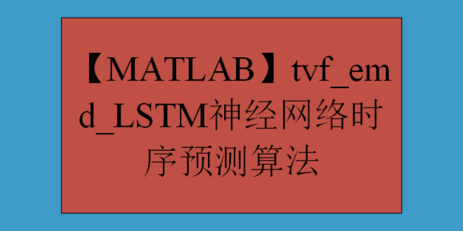

# MATLAB: tvf_emd_LSTM Neural Network Time Series Forecasting Algorithm

TVF-EMD-LSTM is a time series prediction algorithm that integrates Variational Mode Decomposition (VMD), Empirical Mode Decomposition (EMD), and Long Short-Term Memory Neural Network (LSTM).

VMD is an adaptive signal decomposition method that can decompose complex signals into multiple Intrinsic Mode Functions (IMF) and accurately restore the original signal. By using VMD, we can effectively extract complex patterns and trends in the time series for subsequent prediction, providing a more accurate data representation.

EMD is a signal analysis method based on the inherent characteristics of data, capable of decomposing complex signals into a series of Intrinsic Mode Functions (IMF) and handling nonlinear and non-stationary signals. Through EMD, we can convert time series data into a series of IMFs, which can better represent the complex patterns and trends in the time series.

LSTM is a deep learning model particularly suitable for time series data with long-term dependencies. LSTM introduces memory units to learn and remember historical information, allowing the model to consider patterns and trends over long periods during time series prediction.

The basic idea of the TVF-EMD-LSTM algorithm is to decompose the raw time series through VMD and EMD, obtaining a series of Intrinsic Mode Functions (IMF) and a residual term. Then, these IMFs are used as inputs for LSTM training and prediction. By constructing multiple independent LSTM models with different initialization conditions and parameter settings, each model will train and predict the time series. Finally, the predictions from all models are integrated, such as by averaging or weighted averaging, to obtain the final prediction result.
The advantage of the TVF-EMD-LSTM algorithm lies in its ability to handle nonlinear, non-stationary time series data and learn long-term dependencies within the time series. VMD and EMD are capable of extracting complex patterns and trends from time series, providing more accurate input data for LSTM. Meanwhile, LSTM is able to learn these patterns and trends' long-term dependencies, further enhancing the accuracy and stability of predictions.
In practical applications, the TVF-EMD-LSTM algorithm can be utilized across various fields such as financial market prediction, meteorological forecasting, energy consumption prediction, etc. However, it should be noted that this algorithm also has some potential limitations, such as high computational complexity and the need for large amounts of data. Therefore, when using this algorithm, appropriate adjustments and optimizations should be made based on actual needs.

## Images

<!-- PAYMENT_BLOCK -->

## Get this dataset

- Payment link (Stripe): [Buy now](https://buy.stripe.com/3cs8yP7sY87d0vu9AB)
- Payment QR code: 

<!-- /PAYMENT_BLOCK -->
